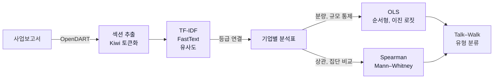

# ESG Disclosure Language and Ratings

## Overview

상장기업 사업보고서의 **ESG 공시 언어와 KCGS 등급의 관계** 분석. 보고서 분량과 기업 규모를 고려해 환경, 사회, 지배구조 표현을 비교하고, 공시 언어와 외부 평가의 상대적 차이로 기업을 분류.

    

## Data

| Item | Details |
|---|---|
| Reports | OpenDART 사업보고서 II, IV, VI 섹션 |
| Sample | **127개 상장기업**, 2022–2024년 **381개 기업-연도** |
| Ratings | KCGS 종합 및 E, S, G 등급 |
| Features | ESG 어휘 빈도, TF-IDF, 확장 사전 점수, 유사도, 보고서 분량 |
| Controls | 보고서 분량과 기업 규모, 재무 통제 모형은 결측 제외 후 **344개 기업-연도** |

원문 보고서와 개별 ESG 등급은 공개 제외. 공개 파일 구성은 [Data](data/README.md) 참조.

## Research Design

1. **사업보고서 수집과 등급 연결**

   - OpenDART API로 사업보고서를 수집하고 분석 대상 섹션 추출
   - 종목코드, DART 기업번호, 접수번호, 사업연도로 자료 연결

2. **한국어 문장을 분석용 토큰으로 변환**

   - **Kiwi 형태소 분석**에 사용자 사전과 불용어 목록 적용
   - 기존 비교에서 사용자 사전 적용 후 ESG 핵심어 보존율 **60% → 93%**, 복합어 보존을 기준으로 Kiwi 채택
   - ESG 관련 표현과 상투적 재무 표현을 구분하고 보고서별 분량 계산

3. **ESG 어휘 점수 생성**

   - **TF-IDF**로 문서 안의 단어 빈도와 문서 간 희소성을 반영
   - **FastText**의 유사어로 E, S, G 사전을 확장하고 어휘강도와 코사인 유사도 계산

4. **등급과의 관계를 통계 및 회귀분석으로 비교**

   - **Spearman 상관**으로 어휘 점수와 등급의 순위 관계 확인
   - **Mann–Whitney 검정**으로 고등급과 저등급 집단의 점수 분포 비교
   - **OLS, 순서형 로짓, 이진 로짓**으로 분석하고 보고서 분량, 기업 규모를 통제한 결과 비교

5. **공시 언어와 등급의 차이로 유형 분류**

   - 분량을 조정한 공시 언어 점수와 등급의 상대적 위치를 **Talk–Walk Matrix**로 구성
   - 중앙값 기준으로 과잉공시, 과소공시, 정합, 일관저조의 네 유형 분류

## Analysis Workflow



## Key Results

### Report Length and Governance

- **381개 기업-연도**에서 보고서 분량과 종합 등급의 Spearman 상관 **ρ=0.6614** 기록
- 재무 통제 모형에서는 **G 어휘 계수만 유의**, E와 S 계수는 유의수준에 도달하지 않음
- 아래 회귀 비교는 재무자료 결측을 제외한 **344개 기업-연도** 기준

<p align="center">
  
</p>
<p align="center"><sub>M1은 분량 통제, M2는 재무 통제 추가 모형. 계수는 등급과의 조건부 연관을 나타냄.</sub></p>

### Talk–Walk Matrix

- 공시 언어와 등급의 상대적 위치가 다른 유형은 **168개 기업-연도**, 전체의 약 **44%**
- 유형별 규모는 과잉공시 **72**, 과소공시 **96**, 정합 **119**, 일관저조 **94**
- 기업 규모를 추가로 통제한 비교 표본 **N=363**에서도 기존 유형과의 일치율 **90.9%**
- 분류는 언어와 등급의 상대적 차이이며, 실제 ESG 성과나 그린워싱 여부를 판정한 결과가 아님

<p align="center">
  
</p>
<p align="center"><sub>분량을 조정한 언어 점수와 등급의 중앙값 기준 분류, N=381.</sub></p>

### Differences Across ESG Dimensions

- **381개 기업-연도 중 180개, 47.2%**에서 한 ESG 축의 공시 언어는 등급보다 상대적으로 높고 다른 축은 낮게 나타남
- 종합 점수에서 가려지는 E, S, G 축별 차이이며, 실제 과장이나 은폐 여부를 판정한 결과가 아님

## Limitations

- **측정 범위:** ESG 성과 자체가 아닌 공시 언어와 외부 평가의 연관 분석
- **표본과 연도:** 보고서 섹션, 사전 구성, 재무 결측 제외와 사업연도 및 등급연도 대응에 따라 해석 범위 제한
- **모형 조건:** S 순서형 로짓의 비례오즈 가정과 G seed 이진 로짓의 분리 문제로 일부 사양 해석 제한
- **인과 해석:** 언어 사용이 등급을 변화시킨다는 인과효과를 의미하지 않음

## Repository Structure

```text
├── notebook/   # 통합 분석 코드
├── src/        # 수집, 전처리, 특성 생성 모듈
├── scripts/    # 단계별 실행 스크립트
├── data/       # 기업 식별정보와 분석 사전
├── results/    # 공개 통계 결과표
└── paper/      # 분석 보고서와 대표 그림
```

[Notebook](notebook/README.md), [Scripts](scripts/README.md), [Source](src/README.md), [Data](data/README.md), [Results](results/README.md), [Paper](paper/README.md)

